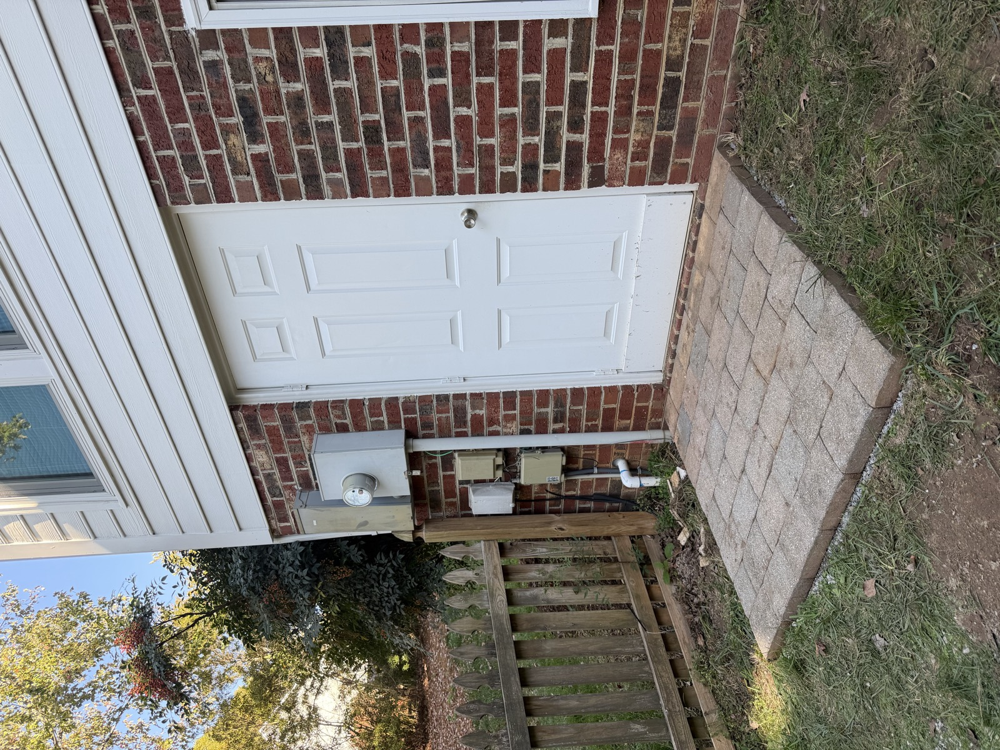
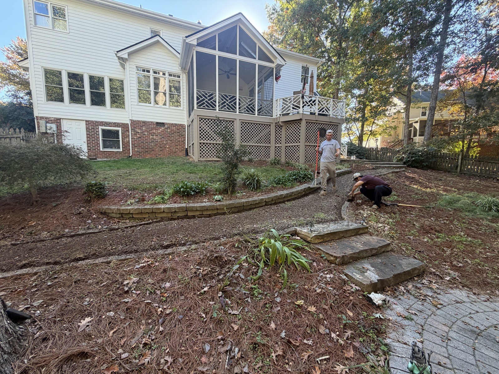
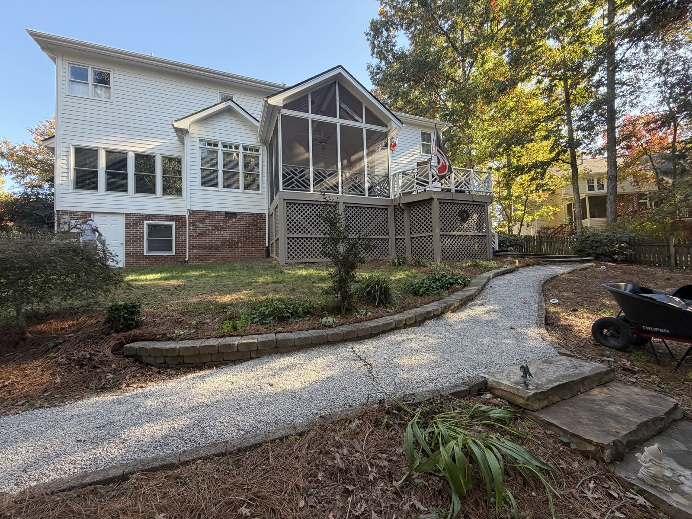

# Planning a Paver Walkway in Raleigh or Cary: What to Consider

A paver walkway can connect your driveway, front door, patio, or other parts of your yard. Before choosing a style, think about where the path should go, how you’ll use it, and what is already in the way.

Here are a few things to consider before requesting an estimate.

## Start with where the walkway will go

Think about the places you walk most often. Do you need a path from the driveway to the front door? A connection from the patio to the yard? Or a better way to reach a side entrance?

Walk the route and look for steps, trees, equipment, or other features the path needs to work around. Photos of the full area can help explain what you have in mind.

## Decide how you’ll use the path

Consider who will use the walkway and whether you need room to carry items, move a bin, or walk side by side. These details can help you discuss the right width and layout for your space.

A straight path may fit some yards, while a curved path may work better around existing features. The best layout depends on your property and how you want to use it.

## Choose a look that fits your home

Pavers come in different shapes, colors, and patterns. You may want the walkway to complement an existing patio, porch, or driveway. If you see a style you like, save a photo to share when you request an estimate.

## Look at the ground and drainage

Show your contractor any slopes, existing surfaces, or places where water collects. Doors, steps, and nearby utilities matter too. The site needs to be assessed before the preparation and drainage work can be determined.

If standing water is already a concern, you can also ask YardU about [yard drainage](/services/drainage/).

## See a YardU landing and walkway project

In another YardU project, the photos show a side-door landing before and after the work, along with a path during the work and afterward. The path photos show progress and the later surface; they aren’t a before-and-after pair from the start of the project.

The first photo shows work in progress; the second shows the path afterward.

[See the landing and walkway photos](/projects/#paver-landing-refresh) for a closer look. Every property is different, so the layout and scope for your walkway will depend on your space.

## What should you include in an estimate request?

Share a few photos and tell us:

- Where you want the path to start and end.
- About how long and wide you’d like it to be.
- How you plan to use it.
- What existing surfaces, steps, or features are nearby.
- Whether water collects in the area.
- Any paver style or budget you have in mind.

Ask what preparation, materials, cleanup, price, and timing are included in the estimate. If you have community or property requirements, bring those up too.

## Plan your walkway with YardU

YardU offers [hardscaping services](/services/hardscaping/) in Raleigh, Cary, and nearby communities. If you’re planning a paver walkway or landing, [request a free estimate](/getestimate/) and share a few details about your space.
